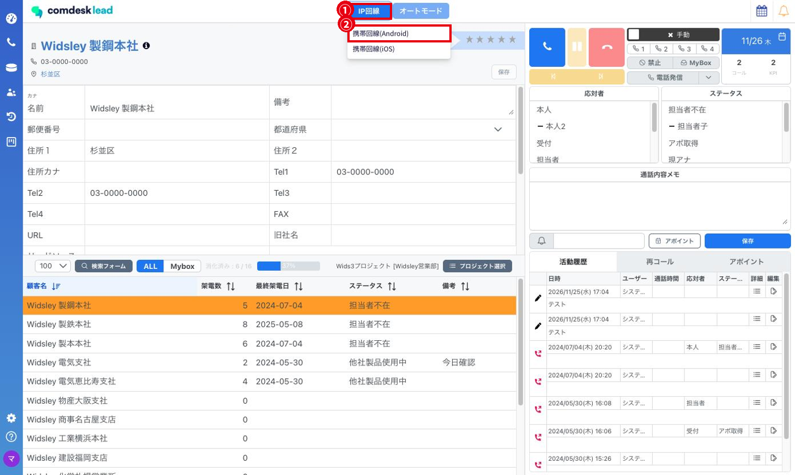
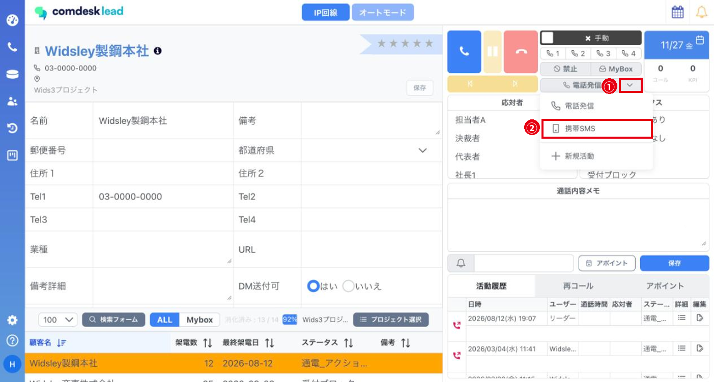
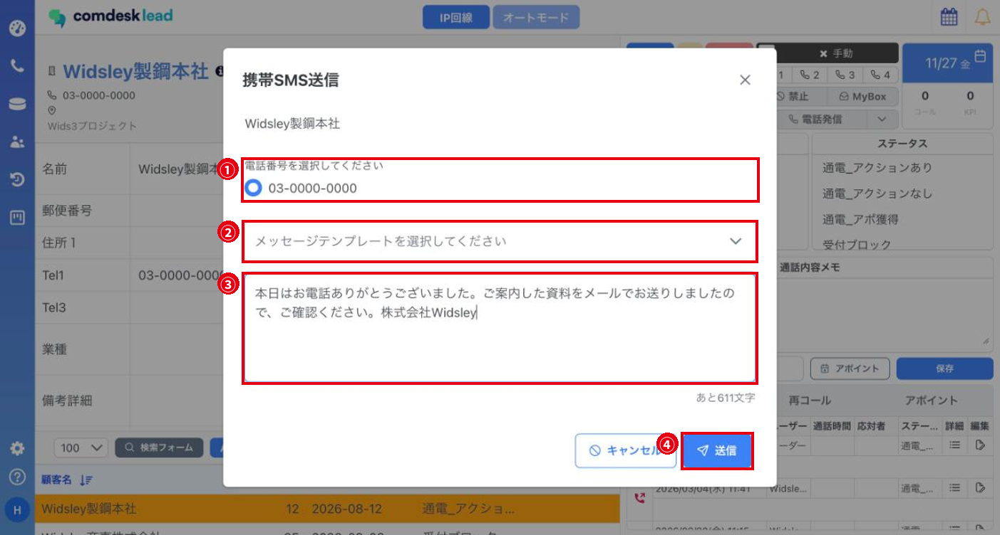

<Info>
2026年11月26日（木）夜間リリースにより、11月27日（金）以降はコール画面のデザインが変更となりました。本記事は変更後の画面でご案内しています。変更内容は[リリースノート](/release/notes/2026-11-26-release-notes)をご確認ください。
</Info>

<Warning>
SMS機能は有料オプションサービスです。ご契約でないお客様は、担当CSまでお問い合わせください。
</Warning>

リストの顧客電話番号が携帯電話番号であれば、SMSを送信できます。

<Steps>
  <Step title="回線種別で携帯回線(Android)を選択する">
    画面上部の回線種別ボタン（①）をクリックし、「携帯回線(Android)」（②）を選択します。

    <Frame caption="回線種別の選択">
      
    </Frame>
  </Step>
  <Step title="送信先のリストを選択する">
    画面下部のリストから、送信先の顧客をクリックします。
  </Step>
  <Step title="「携帯SMS」を選択する">
    画面右上の「電話発信」の右側にある「∨」（①）をクリックし、表示されたメニューから「携帯SMS」（②）を選択します。

    <Frame caption="電話発信メニュー">
      
    </Frame>
  </Step>
  <Step title="本文を入力して送信する">
    「携帯SMS送信」画面で、送信先の電話番号（①）を選択します。テンプレートがある場合は、「メッセージテンプレートを選択してください」（②）から選ぶと、本文欄にテンプレート文が入ります。

    本文（③）を入力し、「送信」ボタン（④）をクリックします。

    <Frame caption="携帯SMS送信画面">
      
    </Frame>
  </Step>
  <Step title="送信履歴を確認する">
    SMS送信後、コール画面右下の「活動履歴」タブにSMS送信履歴が残ります。
  </Step>
</Steps>

SMSのテンプレート作成方法は[SMSテンプレート作成](/features/advanced/12789002610329)をご確認ください。

その他ご不明点などございましたら、[**サポートチームまでお問い合わせ**](#contact)をお願い致します。
