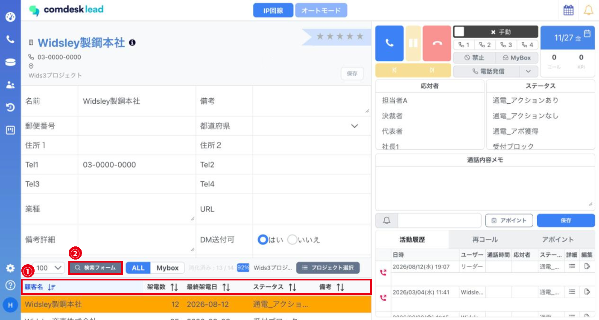

<Info>
2026年11月26日（木）夜間リリースにより、11月27日（金）以降はコール画面のデザインが変更となりました。本記事は変更後の画面でご案内しています。変更内容は[リリースノート](/release/notes/2026-11-26-release-notes)をご確認ください。
</Info>

通常コールモードや配布コールモードでは、画面下部に表示されるリストの表示順を変更できます。

## リストを並び替える

画面下部に表示されるリストの項目名（顧客名・架電数・最終架電日・ステータス・備考）の右側にある「↑↓」（①）を選択すると、表示順を変更できます。

## リストを検索する

リスト上部の「検索フォーム」ボタン（②）から、条件を指定して検索できます。

<Frame caption="リストの並び替えボタンと検索フォーム">
  
</Frame>

検索フォームの使い方は[コールモードでのリスト操作](/features/advanced/12882387147161)をご確認ください。

その他ご不明点などございましたら、[**サポートチームまでお問い合わせ**](#contact)をお願い致します。
