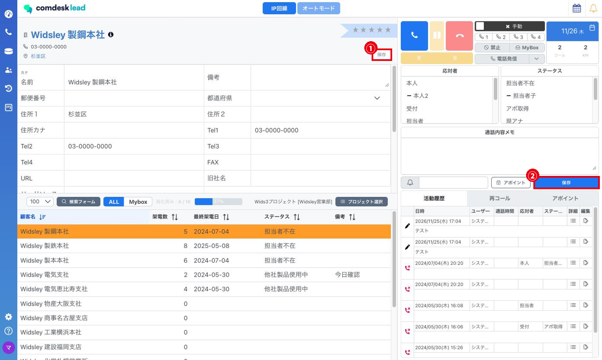
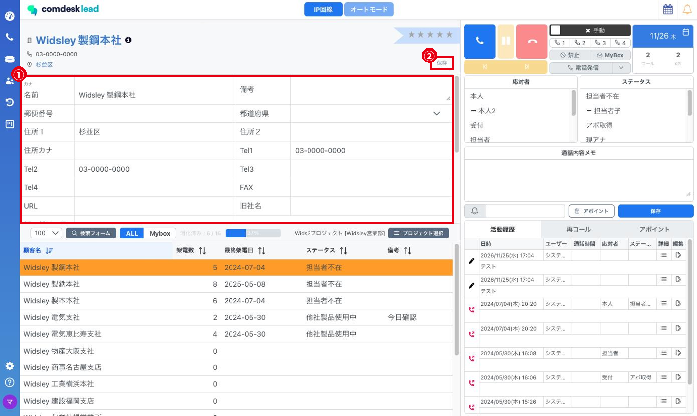
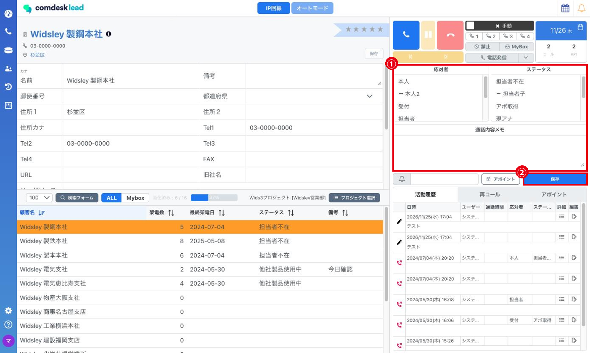

<Info>
2026年11月26日（木）夜間リリースにより、11月27日（金）以降はコール画面のデザインが変更となりました。本記事は変更後の画面でご案内しています。変更内容は[リリースノート](/release/notes/2026-11-26-release-notes)をご確認ください。
</Info>

コール画面には、保存ボタンが2つあります（赤枠）。

| 保存ボタン | 場所 | 使用する場面 |
| --- | --- | --- |
| ① リスト項目の保存 | 顧客詳細情報の右上 | 「リスト項目」に登録されている情報を編集し、保存するとき |
| ② アクティビティ結果の保存 | 通話内容メモの下（青いボタン） | 架電終了後に、架電結果（応対者・ステータスなど）を保存するとき |

<Frame caption="コール画面の2つの保存ボタン">
  
</Frame>

## リスト項目の保存

顧客詳細情報の右上にある保存ボタンは、赤枠内の「リスト項目」に登録されている情報を編集し、保存する際に使用します。

<Frame caption="リスト項目の保存">
  
</Frame>

## アクティビティ結果の保存

通話内容メモの下にある青い保存ボタンは、架電終了後に赤枠内の架電結果（応対者・ステータス・通話内容メモ）を保存する際に使用します。

<Frame caption="アクティビティ結果の保存">
  
</Frame>

編集した項目に応じて、適切な保存ボタンをご利用ください。

その他ご不明点などございましたら、[**サポートチームまでお問い合わせ**](#contact)をお願い致します。
