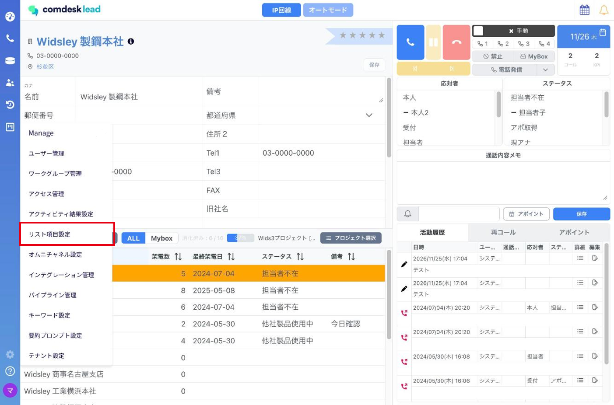
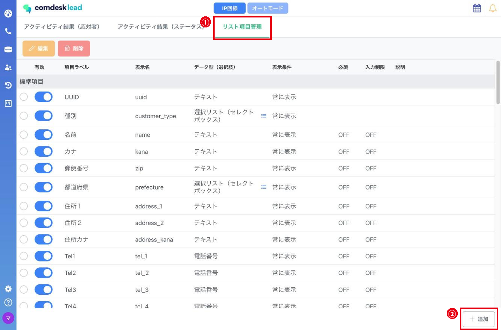
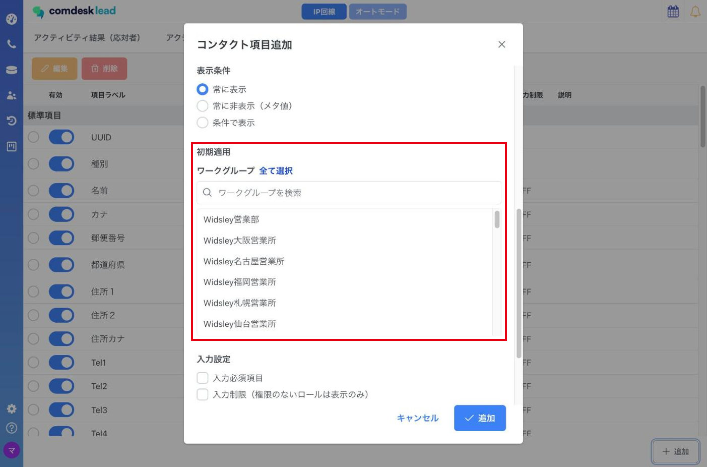
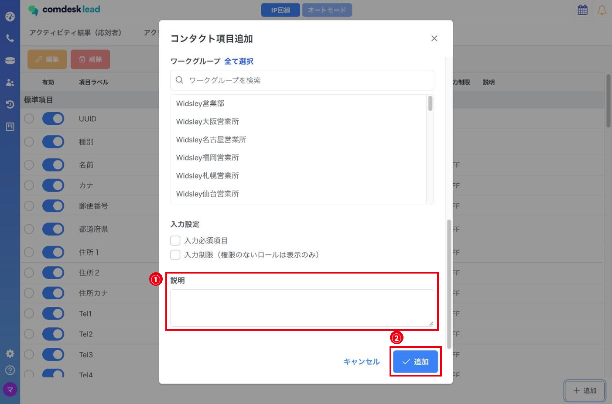
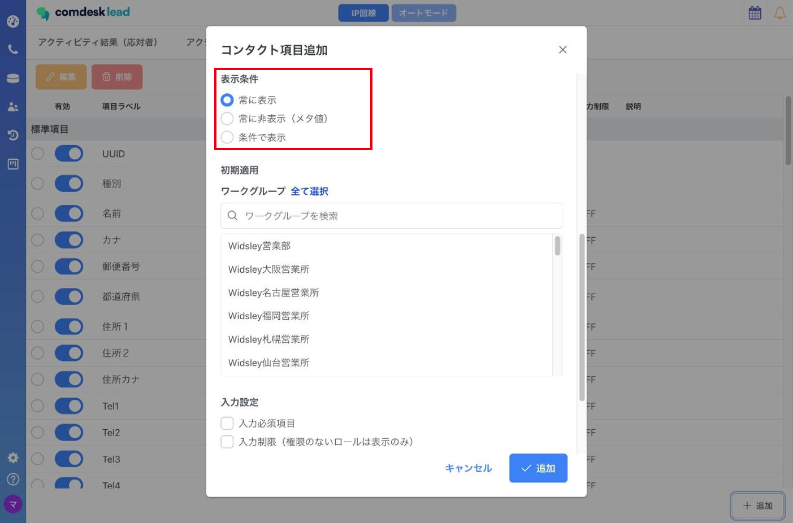
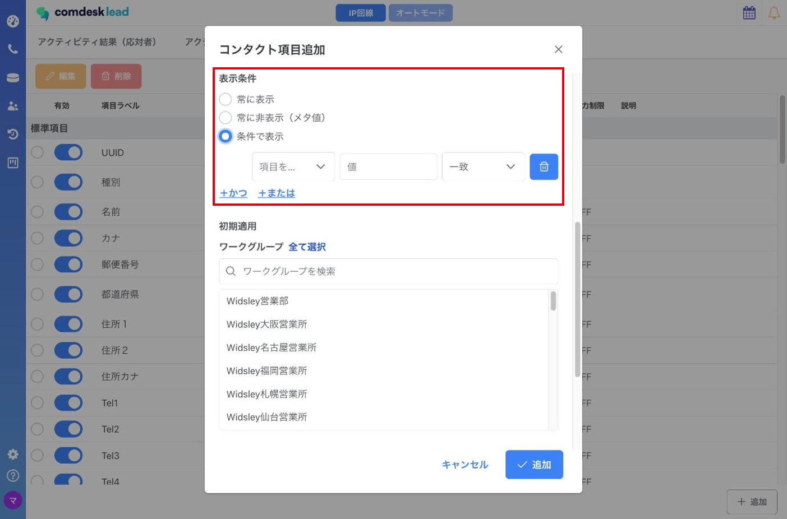
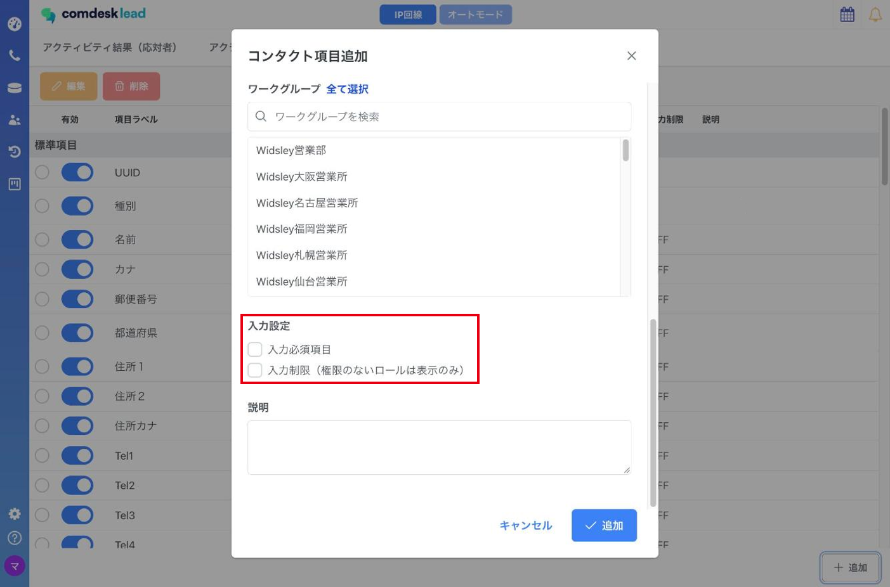

<Info>
2026年11月26日（木）夜間リリースにより、11月27日（金）以降はリスト項目管理のデザインが変更となりました。本記事は変更後の画面でご案内しています。変更内容は[リリースノート](/release/notes/2026-11-26-release-notes)をご確認ください。
</Info>

標準項目だけでは足りない項目は、カスタム項目として追加できます。カスタム項目は、作成時に適用するワークグループを選択すると、コールモード画面などで使えるようになります。

## リスト項目の種類

| 種類 | 説明 |
| --- | --- |
| 標準項目 | 初めから用意されている項目です。 |
| カスタム項目 | 自由に追加・作成できる項目です。 |

## 項目ラベルと項目名

| 名称 | 説明 |
| --- | --- |
| 項目ラベル | コールモード画面に表示される名称です。 |
| 項目名 | 内部処理で使用する名称です。半角英数字で入力します。 |

## カスタム項目を作成する

<Steps>
  <Step title="リスト項目設定を開く">
    画面左下の歯車アイコンにカーソルを合わせます。［Manage］メニューが表示されたら、［リスト項目設定］を選択します。

    <Frame caption="［リスト項目設定］を選択">
      
    </Frame>
  </Step>
  <Step title="項目の追加を始める">
    ［リスト項目管理］タブ（①）を開き、画面右下の［追加］（②）を押します。

    <Frame caption="［リスト項目管理］タブと［追加］">
      
    </Frame>
  </Step>
  <Step title="項目ラベル・項目名・データ型を入力する">
    ［コンタクト項目追加］画面で、項目ラベル（①）と項目名（②）を入力し、データ型（③）を選択します。

    データ型で［日付］を選んだ場合は、「日付＋時刻」「日付のみ」「時刻のみ」から入力形式を選択します。

    <Frame caption="項目ラベル・項目名・データ型">
      
    </Frame>

    <Note>
    項目ラベル・項目名が未入力の場合や、文字数の上限を超えている場合、ほかの項目と重複している場合は、エラーが表示され保存できません。
    </Note>
  </Step>
  <Step title="適用するワークグループを選択する">
    ［初期適用］で、項目を使うワークグループにチェックを入れます。すべてのワークグループで使う場合は、［全て選択］を押します。

    <Frame caption="［初期適用］のワークグループ">
      
    </Frame>

    <Warning>
    ワークグループの適用は、項目を追加するときだけ設定できます。あとから項目を編集しても、ワークグループの適用は変わりません。
    </Warning>
  </Step>
  <Step title="説明を入力して追加する">
    必要に応じて説明（①）を入力し、［追加］（②）を押します。

    表示条件・入力必須項目・入力制限を設定する場合は、［追加］を押す前に設定してください。詳しくは**任意で設定できる項目**をご確認ください。

    <Frame caption="説明と［追加］">
      
    </Frame>
  </Step>
</Steps>

## 任意で設定できる項目

次の項目は、必要な場合のみ設定してください。設定しなくても項目は作成できます。

### 表示条件

コールモード画面などに項目を表示するかどうかを設定します。初期値は「常に表示」です。表示条件を設定できるのはカスタム項目のみです。

| 表示条件 | 説明 |
| --- | --- |
| 常に表示 | コールモード画面に常に表示します（初期値）。 |
| 常に非表示（メタ値） | コールモード画面には表示せず、値だけを持たせます。管理用の値や、ほかの項目の表示条件に使う値などに使います。 |
| 条件で表示 | ほかの項目の値が条件に合う顧客のときだけ表示します。 |

<Frame caption="表示条件">
  
</Frame>

<AccordionGroup>
  <Accordion title="「条件で表示」の設定方法">

    ［条件で表示］を選択すると、条件の入力欄が表示されます。左から「条件に使う項目」「値」「条件」を選択してください。

    - 条件は2つまで設定できます。［＋かつ］は両方の条件を満たすとき、［＋または］はどちらかの条件を満たすときに表示します。
    - 条件は、右のゴミ箱ボタンで削除できます。
    - ［条件で表示］を選んで条件を入力しないままでは、保存できません。

    <Frame caption="条件で表示">
      
    </Frame>

    条件に使う項目のデータ型によって、値の入れ方と選べる条件が変わります。

    | 条件に使う項目のデータ型 | 値の入れ方 | 選べる条件 |
    | --- | --- | --- |
    | テキスト・テキストエリア・検索項目・電話番号 | テキストで入力 | 一致／以外 |
    | 数値 | 数値で入力 | 一致／以外／以上／以下 |
    | 選択リスト（ラジオボタン・セレクトボックス） | 選択肢から1つ選択 | 一致／以外 |
    | チェックボックス（T/F） | 「はい」「いいえ」から選択 | 一致／以外 |
    | 複数選択（チェックリスト） | 選択肢から複数選択 | 含む／含まない／一致 |
    | 日付 | 項目の入力形式に合わせて入力 | 一致／以外／以上／以下 |

    <Note>
    複数選択の「含む」は指定した値をすべて含むとき、「含まない」は指定した値をどれも含まないとき、「一致」は選択の組み合わせが同じとき（順番は問いません）に表示します。
    </Note>
  </Accordion>
  <Accordion title="表示条件が反映される画面">

    | 画面 | 表示条件 |
    | --- | --- |
    | コールモード（通常・自動配布・新規） | 反映されます |
    | 受電ダイアログ・再コールダイアログ | 反映されます |
    | コンタクト管理（顧客詳細・編集） | 反映されます |
    | コンタクト管理（コンタクト追加） | 反映されません（すべての項目が表示されます） |
    | ComDesk Phone | 対象外です |

    コールモード画面などで条件に使う項目の値を変更すると、保存前でもその場で表示・非表示が切り替わります。
  </Accordion>
  <Accordion title="「常に非表示（メタ値）」と「無効」の違い">

    | | 無効（一覧の［有効］をOFF） | 常に非表示（メタ値） |
    | --- | --- | --- |
    | コールモードなどの入力画面 | 表示されません | 表示されません |
    | コンタクト管理の一覧・CSVエクスポート | 表示されません | 表示されます |
    | コンタクト管理のコンタクト追加 | 表示されません | 表示されます（値を入力できます） |
    | ほかの項目の表示条件に使う | 使えません | 使えます |

    使わなくなった項目は「無効」、値は残してオペレーターの入力画面には表示しない項目は「常に非表示（メタ値）」をご利用ください。
  </Accordion>
</AccordionGroup>

### 入力必須項目・入力制限

［入力設定］で設定します。初期値はいずれもOFFです。必要な場合のみチェックを入れてください。入力必須項目・入力制限は、カスタム項目だけでなく標準項目にも設定できます。ただし、UUID・種別（個人/組織）には設定できません。

| 設定 | 説明 |
| --- | --- |
| 入力必須項目 | 空欄のまま保存しようとすると「必須項目が入力されていません」と表示され、保存されません。入力画面では項目名の横に赤い「＊」が付きます。 |
| 入力制限（権限のないロールは表示のみ） | 権限のないユーザーには、入力欄ではなく値だけが表示されます。 |

<Frame caption="入力設定">
  
</Frame>

<AccordionGroup>
  <Accordion title="入力制限の項目を入力・編集できるユーザー">

    | ユーザー | 入力制限の項目 |
    | --- | --- |
    | システム管理者 | 入力・編集できます |
    | マネージャー・SV・リーダー・一般ユーザー | 表示のみ |
    | カスタムロール（機能/ページ「テナント全体」のアクション「「入力制限」にされたリスト項目の編集」をONにしたもの） | 入力・編集できます |

    システム管理者以外のユーザーに入力制限の項目を編集させる場合は、カスタムロールを使います。ユーザー管理の［ロール管理］でカスタムロールを開き、機能/ページ［テナント全体］のアクション［「入力制限」にされたリスト項目の編集］をONにしてください。そのうえで、編集させたいユーザーにこのカスタムロールを割り当てます。

    この権限は、マネージャー・SV・リーダー・一般ユーザーなどの標準ロールには設定できません。カスタムロールの作成方法は[カスタムロールを作成・削除する](/features/advanced/33006613337369)をご確認ください。
  </Accordion>
  <Accordion title="標準項目に入力必須項目・入力制限を設定する場合">

    ［リスト項目管理］の一覧で標準項目（名前・住所など）の左端の丸を選択し、［編集］を押します。表示された画面の［入力設定］で、入力必須項目・入力制限を設定します。

    - 標準項目で変更できるのは、入力設定（入力必須項目・入力制限）のみです。項目ラベル・項目名・データ型・表示条件は変更できません。
    - UUID・種別（個人/組織）は、一覧の［必須］［入力制限］欄が空欄で表示されます。
    - 電話番号の項目（Tel1〜Tel4・FAX）の入力制限は、テナント設定の「電話番号編集制限」で設定します。
  </Accordion>
  <Accordion title="入力必須項目・入力制限が反映される画面">

    - **反映される画面**：コールモード・受電ダイアログ・再コールダイアログ・コンタクト管理（コンタクト追加、顧客詳細・編集）
    - **反映されない操作**：プロジェクト管理のCSVインポート（必須項目が空欄の行や、権限のないユーザーによる値も取り込まれます）
    - **対象外**：ComDesk Phone
  </Accordion>
</AccordionGroup>

<Note>
電話番号の項目（Tel1〜Tel4・FAX・データ型が電話番号の項目）は、入力制限を設定できません。電話番号の編集制限は、テナント設定の「電話番号編集制限」で設定します。
</Note>

<Note>
作成した項目をワークグループの画面にどう表示するかは、[ワークグループの表示項目を設定する](/guide/admin/12741114939545)で設定します。
</Note>

ご不明な点がありましたら、[サポートチームまでお問い合わせ](#contact)ください。
