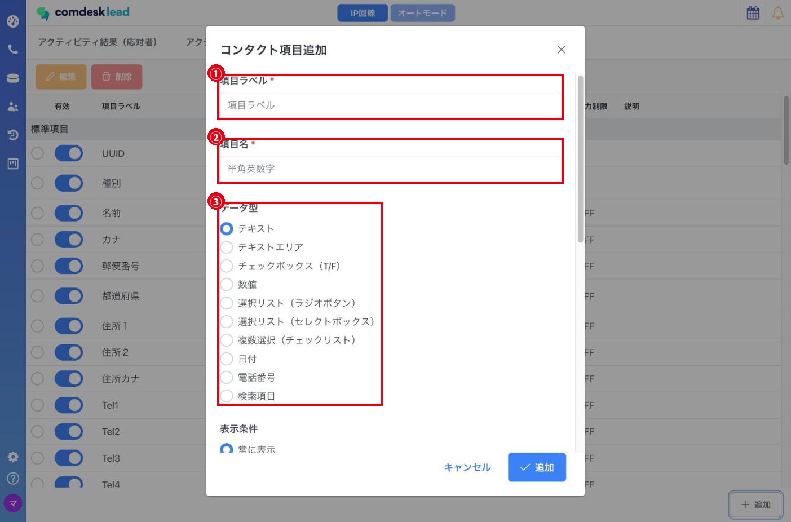
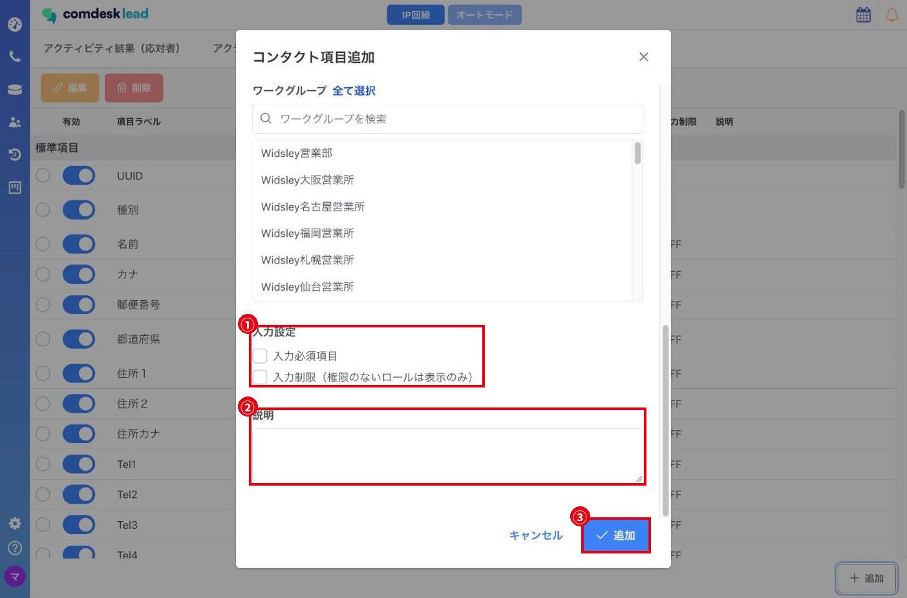

<Info>
2026年11月26日（木）夜間リリースにより、11月27日（金）以降はリスト項目管理のデザインが変更となりました。本記事は変更後の画面でご案内しています。変更内容は[リリースノート](/release/notes/2026-11-26-release-notes)をご確認ください。
</Info>

標準項目だけでは足りない項目は、カスタム項目として追加できます。カスタム項目は、作成時に適用するワークグループを選択すると、コールモード画面などで使えるようになります。

## リスト項目の種類

| 種類 | 説明 |
| --- | --- |
| 標準項目 | 初めから用意されている項目です。 |
| カスタム項目 | 自由に追加・作成できる項目です。 |

## 項目ラベルと項目名

| 名称 | 説明 |
| --- | --- |
| 項目ラベル | コールモード画面に表示される名称です。 |
| 項目名 | 内部処理で使用する名称です。半角英数字で入力します。 |

<Steps>
  <Step title="リスト項目設定を開く">
    画面左下の歯車アイコンにカーソルを合わせます。［Manage］メニューが表示されたら、［リスト項目設定］を選択します。

    <Frame caption="［リスト項目設定］を選択">
      
    </Frame>
  </Step>
  <Step title="項目の追加を始める">
    ［リスト項目管理］タブ（①）を開き、画面右下の［追加］（②）を押します。

    <Frame caption="［リスト項目管理］タブと［追加］">
      
    </Frame>
  </Step>
  <Step title="項目ラベル・項目名・データ型を入力する">
    ［コンタクト項目追加］画面で、項目ラベル（①）と項目名（②）を入力し、データ型（③）を選択します。

    <Frame caption="項目ラベル・項目名・データ型">
      
    </Frame>
  </Step>
  <Step title="表示条件と適用するワークグループを選択する">
    表示条件（①）を選択し、［初期適用］で項目を使うワークグループ（②）にチェックを入れます。すべてのワークグループで使う場合は、［全て選択］を押します。

    | 表示条件 | 説明 |
    | --- | --- |
    | 常に表示 | コールモード画面に常に表示します。 |
    | 常に非表示（メタ値） | コールモード画面には表示せず、情報だけを持たせます。連携用の値などに使います。 |
    | 条件で表示 | ほかの項目の値が条件に合うときだけ表示します。 |

    <Frame caption="表示条件と初期適用">
      
    </Frame>

    <Accordion title="「条件で表示」の設定方法">
      ［条件で表示］を選択すると、条件の入力欄が表示されます。対象の項目、値、条件（「一致」など）を選択してください。条件を追加する場合は、［＋かつ］または［＋または］を押します。

      <Frame caption="条件で表示">
        
      </Frame>
    </Accordion>
  </Step>
  <Step title="入力設定・説明を入力して追加する">
    必要に応じて入力設定（①）にチェックを入れ、説明（②）を入力します。入力したら、［追加］（③）を押します。

    | 項目 | 説明 |
    | --- | --- |
    | 入力必須項目 | チェックを入れると、空欄のまま保存しようとしたときにアラートが表示され、保存されません。 |
    | 入力制限 | チェックを入れると、権限のないロールのユーザーには入力欄ではなく値だけが表示されます。 |
    | 説明 | 項目の説明を入力します。 |

    <Frame caption="入力設定・説明と［追加］">
      
    </Frame>

    <Note>
    電話番号の項目（Tel1〜Tel4・FAX・データ型が電話番号の項目）の入力制限は、テナント設定の「電話番号編集制限」で設定します。
    </Note>
  </Step>
</Steps>

<Note>
作成した項目をワークグループの画面にどう表示するかは、[ワークグループの表示項目を設定する](/guide/admin/12741114939545)で設定します。
</Note>

ご不明な点がありましたら、[サポートチームまでお問い合わせ](#contact)ください。
