<Info>
2026年11月26日（木）夜間リリースにより、11月27日（金）以降はコール画面のデザインが変更となりました。本記事は変更後の画面でご案内しています。変更内容は[リリースノート](/release/notes/2026-11-26-release-notes)をご確認ください。
</Info>

本記事では、コール画面での架電方法についてご説明します。

## 1. プロジェクトを選択する

<Steps>
  <Step title="架電対象のプロジェクトを選択する">
    ログイン後に「プロジェクト選択」のポップアップが表示されます。架電対象のプロジェクトをクリックします。

    <Frame caption="プロジェクト選択のポップアップ">
      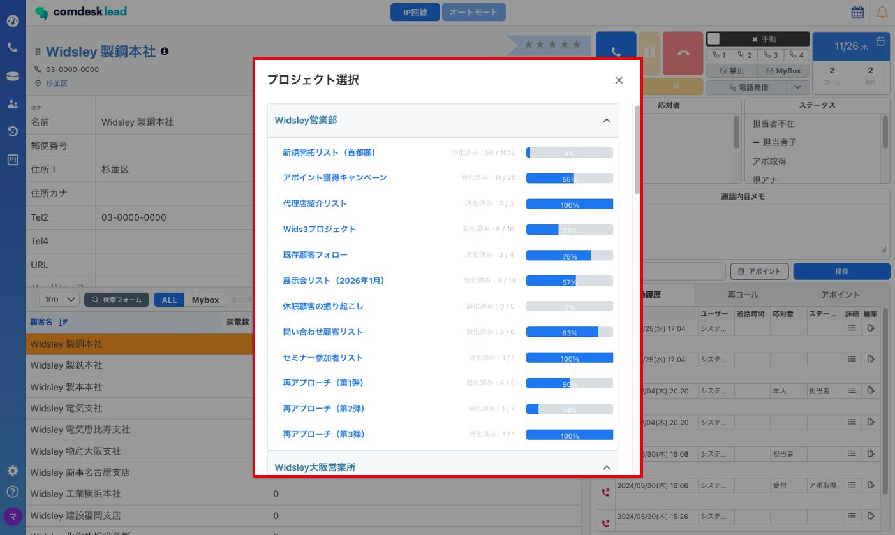
    </Frame>
  </Step>
  <Step title="プロジェクトを変更する場合">
    架電対象のプロジェクトを変更する場合は、画面下部のリスト上にある「プロジェクト選択」ボタンをクリックします。

    <Frame caption="プロジェクト選択ボタン">
      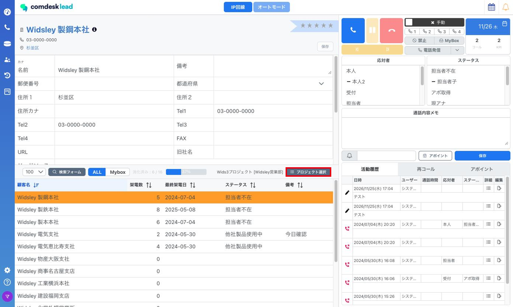
    </Frame>
  </Step>
</Steps>

## 2. 回線種別を選択する

画面上部の回線種別ボタン（①）をクリックすると、選択できる回線（②）が表示されます。ご利用の回線をクリックしてください。

| ご利用の回線 | 選択する回線種別 |
| --- | --- |
| 携帯電話で架電する場合 | ご利用の機種を選択ください（携帯回線(Android)／携帯回線(iOS)） |
| IP回線で架電する場合 | IP回線 |

<Frame caption="回線種別の選択">
  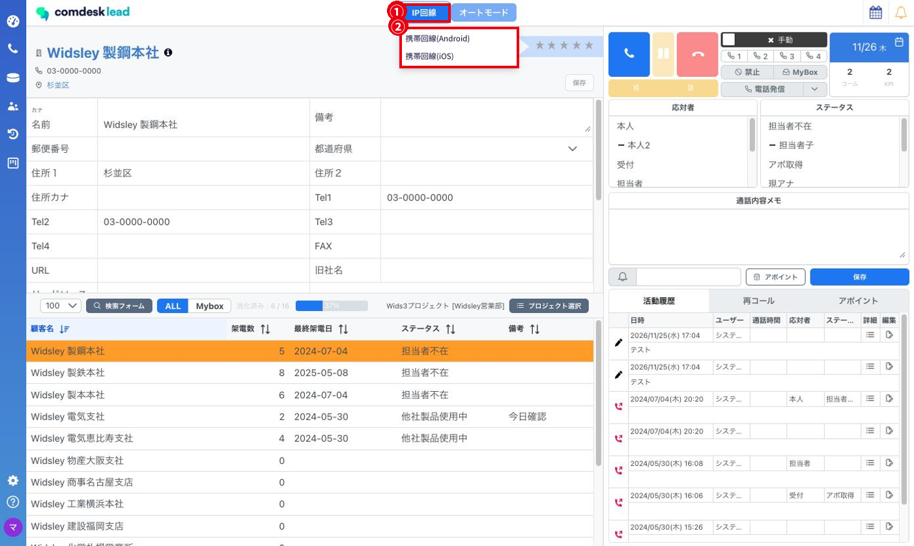
</Frame>

## 3. コールモードを選択する

画面左側メニューの電話アイコンにカーソルを合わせると、「コールモード」メニューが表示されます。利用するコールモードをクリックします。

<Frame caption="コールモードメニュー">
  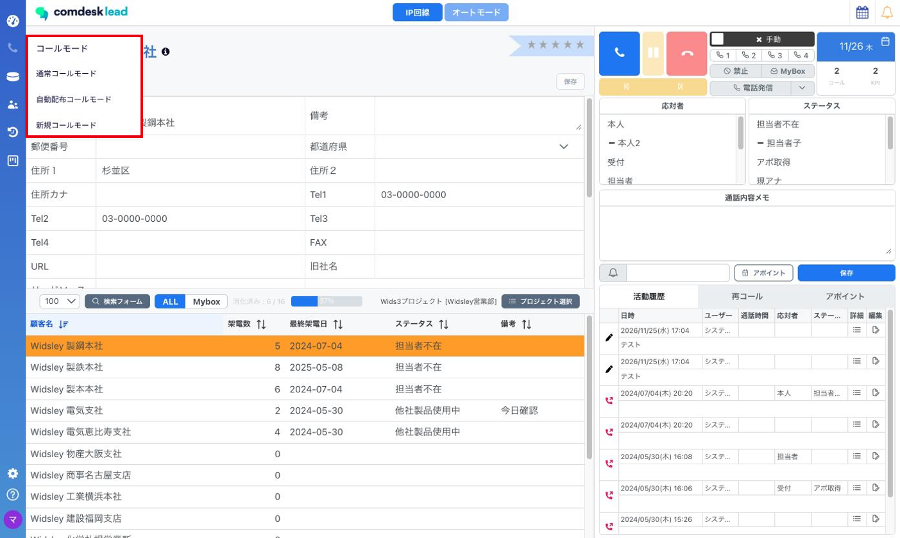
</Frame>

### a. 通常コールモード：選択したプロジェクトにあるリストに架電する

<Steps>
  <Step title="リストを選択する">
    画面下部のリスト（①）から、架電する顧客をクリックします。画面上部（②）に顧客詳細情報が表示されます。

    <Frame caption="リストと顧客詳細情報">
      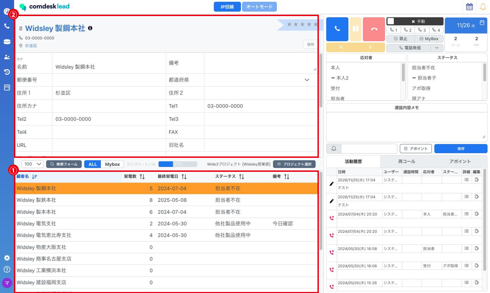
    </Frame>

    <Tip>
    発信ボタンの下にある送りボタン（前へ／次へ）で、リストを順番に切り替えることもできます。

    <Frame caption="送りボタン">
      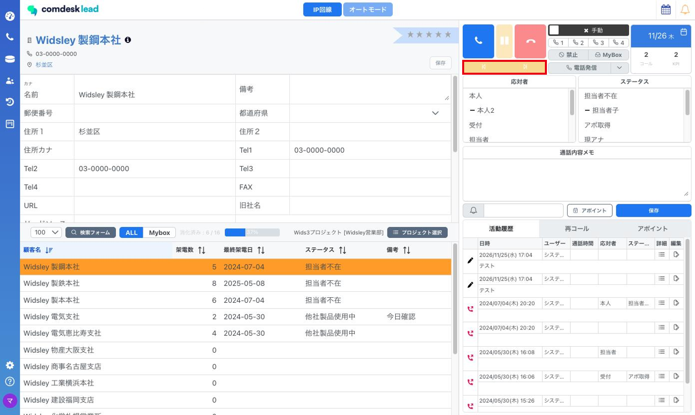
    </Frame>
    </Tip>
  </Step>
  <Step title="発信する">
    発信ボタンをクリックし、架電を行います。

    <Frame caption="発信ボタン">
      
    </Frame>
  </Step>
</Steps>

### b. 新規コールモード：プロジェクト未登録の電話番号に架電する

<Steps>
  <Step title="新規コールモードを開く">
    「コールモード」メニューから「新規コールモード」をクリックします。
  </Step>
  <Step title="電話番号を入力してリストを追加する">
    1. 「選択プロジェクト」に、リストを追加したいプロジェクトが表示されていることを確認します。変更する場合は「プロジェクト変更」ボタン（①）をクリックします。
    2. 電話番号の入力欄（②）に電話番号を入力します。
    3. 入力欄の右側にある「＋」ボタン（③）をクリックします。選択中のプロジェクトにリストが追加されます。

    <Frame caption="新規コールモードでの電話番号の入力">
      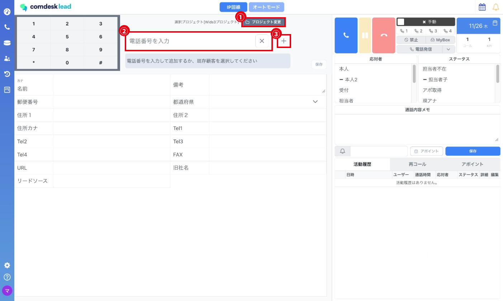
    </Frame>
  </Step>
  <Step title="顧客詳細情報を入力して保存する">
    名前（①）は必須入力項目のため、必ずご入力ください。名前以外の顧客詳細情報も必要に応じて入力し、「保存」ボタン（②）をクリックします。

    <Frame caption="顧客詳細情報の入力と保存">
      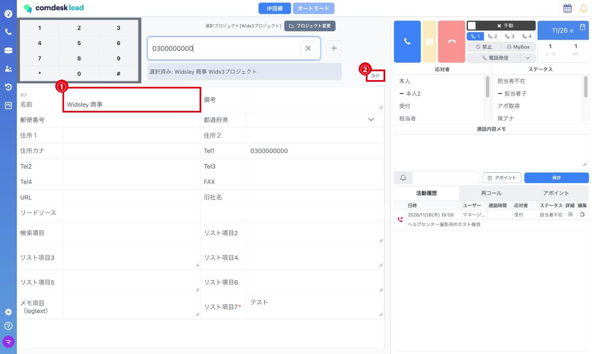
    </Frame>
  </Step>
  <Step title="発信する">
    発信ボタンをクリックし、架電を行います。

    <Frame caption="発信ボタン">
      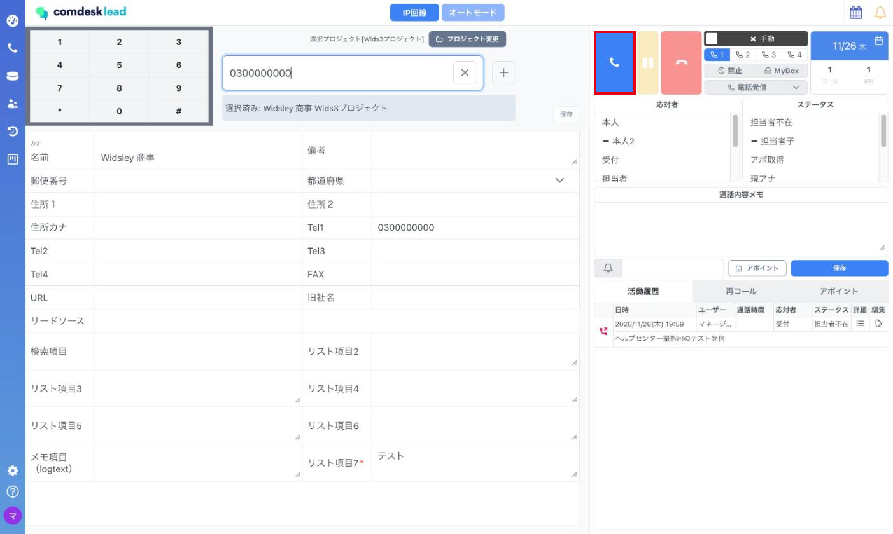
    </Frame>
  </Step>
</Steps>

### c. 自動配布コールモード：複数の担当者で同一プロジェクトに架電する

<Steps>
  <Step title="自動配布コールモードを開く">
    「コールモード」メニューから「自動配布コールモード」をクリックします。
  </Step>
  <Step title="配布ボタンをクリックする">
    画面右上の配布ボタンをクリックすると、1件目のリストが配布されます。

    <Frame caption="配布ボタン">
      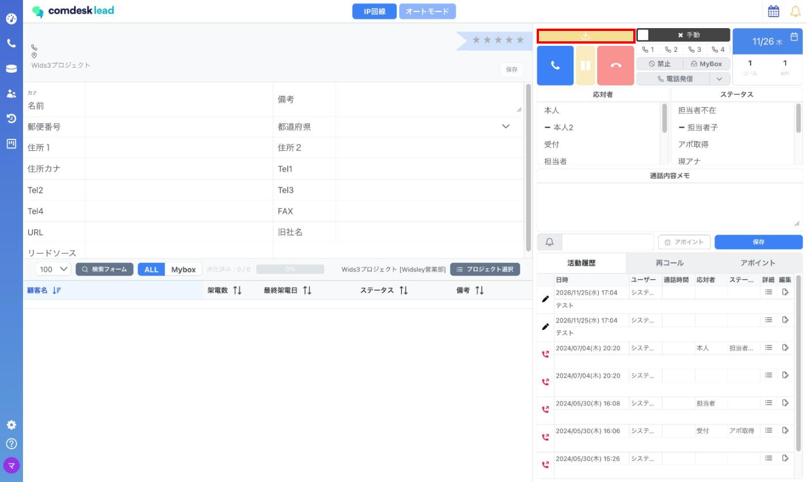
    </Frame>
  </Step>
  <Step title="発信する">
    発信ボタンをクリックし、架電を行います。
  </Step>
</Steps>

## 4. 架電方法

通常コールモードを例に説明します。

<Steps>
  <Step title="架電先を選択する">
    架電先を画面下部のリストから選択してください。
  </Step>
  <Step title="発信する">
    発信ボタンをクリックして架電します。

    電話番号は4つまで登録できます。発信ボタン横の「1」〜「4」ボタンで発信先（Tel1〜Tel4）を選択できます。選択しない場合は、Tel1に発信します。

    <Frame caption="発信先の選択">
      
    </Frame>
  </Step>
  <Step title="通話内容をメモする">
    架電中のメモは「通話内容メモ」に残すことができます。

    <Frame caption="通話内容メモ">
      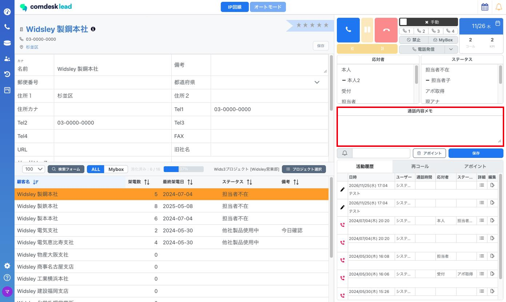
    </Frame>
  </Step>
  <Step title="顧客情報を入力する">
    架電中に顧客情報（①）を入力できます。入力した際には、顧客詳細情報の右上にある「保存」（②）をクリックしてください。

    <Frame caption="顧客情報の入力と保存">
      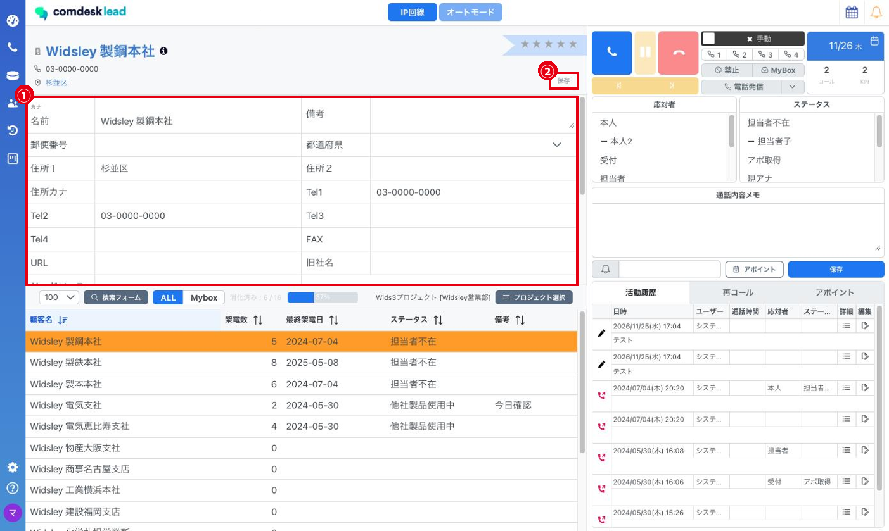
    </Frame>
  </Step>
  <Step title="切電する">
    切電ボタンをクリックします。発信先から切電された場合も、必ず切電ボタンをクリックしてください。

    <Frame caption="切電ボタン">
      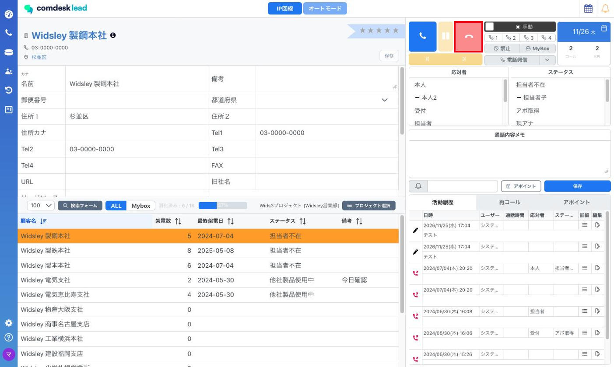
    </Frame>
  </Step>
</Steps>

架電終了後に結果を保存する方法は[架電終了後に結果を保存する](/guide/user/12750855872025)をご確認ください。

## 5. オートコールモード

オートコールモードへ変更する場合は、画面右上の「手動」をクリックし、「オート」の表示に変更します。

<Frame caption="手動／オートの切り替え">
  
</Frame>

オートコールモードの詳細は[オートコールモード](/features/advanced/12775436693273)をご確認ください。

その他ご不明点などございましたら、[**サポートチームまでお問い合わせ**](#contact)をお願い致します。
