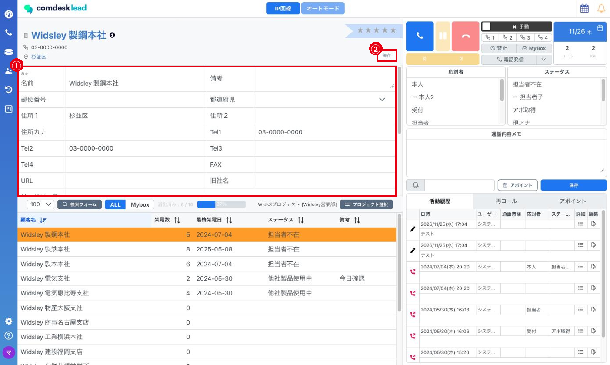

<Info>
2026年11月26日（木）夜間リリースにより、11月27日（金）以降はコール画面のデザインが変更となりました。本記事は変更後の画面でご案内しています。変更内容は[リリースノート](/release/notes/2026-11-26-release-notes)をご確認ください。
</Info>

リストについて追加情報を入手した場合は、リスト情報を更新できます。

<Steps>
  <Step title="リストの追加情報を入力する">
    リスト情報の欄（画像の①）に、追加情報を入力します。
  </Step>
  <Step title="保存する">
    顧客詳細情報の右上にある「保存」ボタン（画像の②）をクリックします。

    <Frame caption="リスト情報の入力欄と保存ボタン">
      
    </Frame>
  </Step>
</Steps>

<Note>
通話内容メモの下にある青い「保存」ボタンは、アクティビティ結果を保存するためのボタンです。リスト情報は保存されませんのでご注意ください。詳しくは[コールモード上に設置してある2つの保存ボタンの違い](/features/advanced/13593474385817)をご確認ください。
</Note>

その他ご不明点などございましたら、[**サポートチームまでお問い合わせ**](#contact)をお願い致します。
