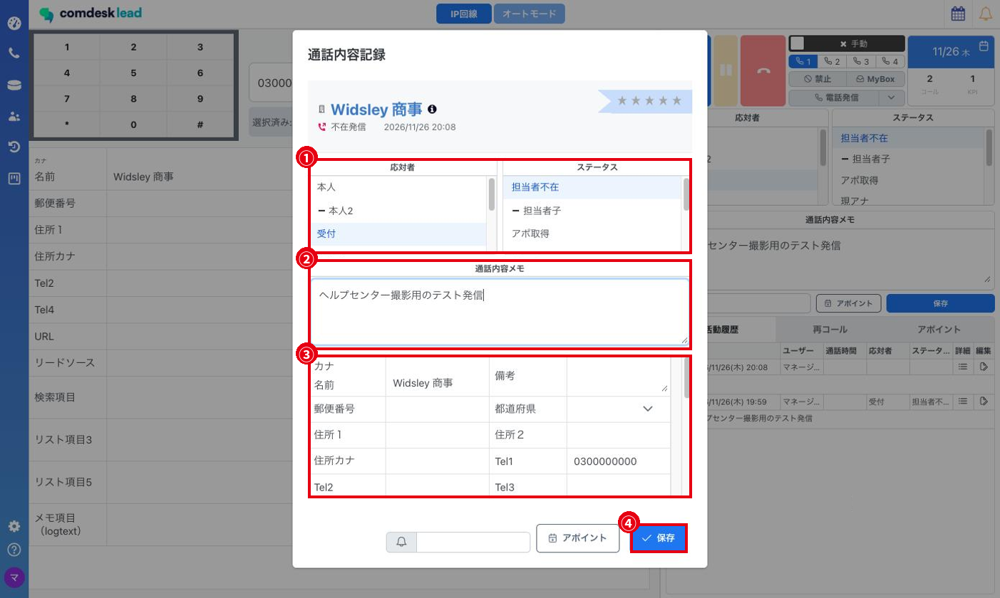
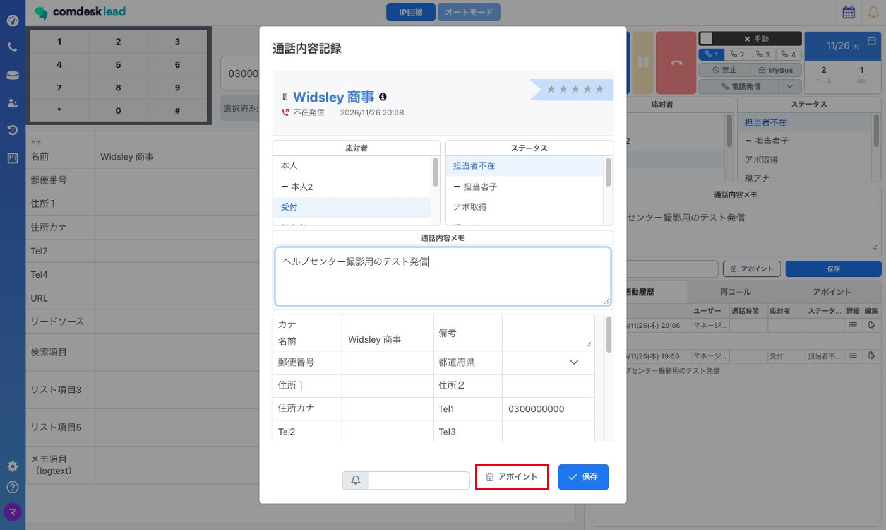
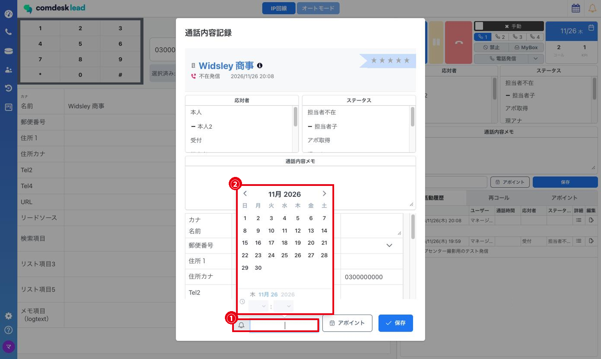
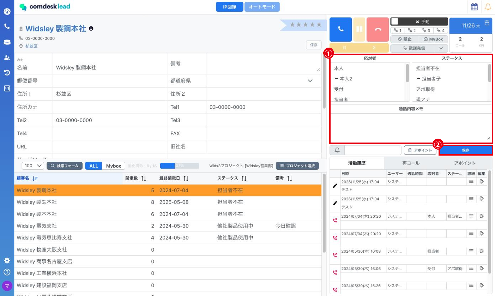
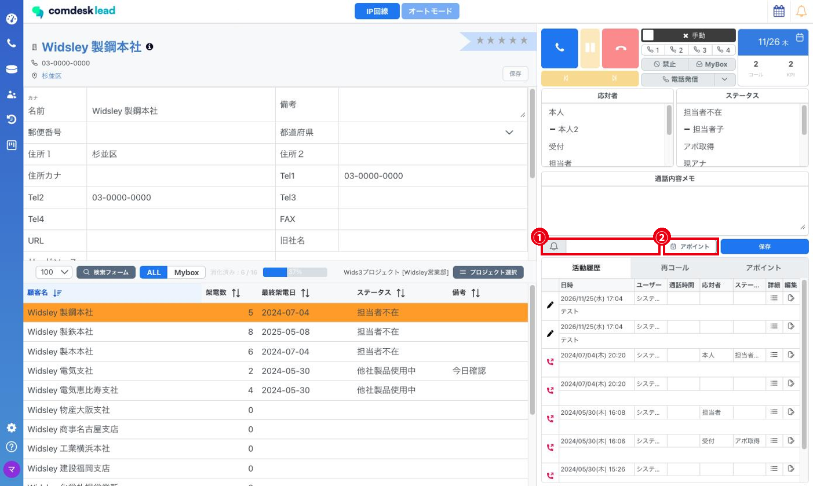

<Info>
2026年11月26日（木）夜間リリースにより、11月27日（金）以降はコール画面のデザインが変更となりました。本記事は変更後の画面でご案内しています。変更内容は[リリースノート](/release/notes/2026-11-26-release-notes)をご確認ください。
</Info>

## 切断時に保存できる項目

- 応対者
- ステータス（必須）
- 通話メモ
- アポイント日時
- 再コール日時
- リスト情報（切断時ポップアップを表示させている場合）

<Info>
切断時ポップアップの表示有無によって、入力する画面が異なります。切断時ポップアップの設定方法は[架電終了時の結果保存画面をポップアップで出す](/features/advanced/12780022937753)をご確認ください。
</Info>

## 切断時ポップアップを表示させている場合

<Steps>
  <Step title="通話内容記録画面で結果を入力する">
    切断時に「通話内容記録」画面が表示されます。必要に応じて以下を入力し、画面右下の「保存」（④）をクリックしてください。

    - 応対者・ステータス（必須）（①）
    - 通話内容メモ（②）
    - リスト情報（③）

    <Frame caption="通話内容記録画面">
      
    </Frame>
  </Step>
  <Step title="アポイントを登録する">
    通話内容記録画面の「アポイント」ボタンを選択すると、アポイントの詳細を登録できるフォームが表示されます。

    <Frame caption="アポイントボタン">
      
    </Frame>
  </Step>
  <Step title="再コール日時を設定する">
    通話内容記録画面の下部にある、ベルアイコン横の入力欄（①）をクリックすると、カレンダー（②）が表示されます。再コールしたい日付と時刻を選択してください。

    <Frame caption="再コール日時の選択">
      
    </Frame>
  </Step>
</Steps>

## 切断時ポップアップを表示させていない場合

<Steps>
  <Step title="画面右側の入力欄で結果を入力する">
    画面右側の入力欄（①）から、必要に応じて以下を入力し、通話内容メモの下にある「保存」（②）をクリックしてください。

    - 応対者
    - ステータス（必須）
    - 通話メモ

    <Frame caption="画面右側の入力欄と保存ボタン">
      
    </Frame>
  </Step>
  <Step title="再コール日時・アポイントを設定する">
    通話内容メモの下にある、ベルアイコン横の入力欄（①）をクリックするとカレンダーが表示されます。再コールしたい日時を選択してください。

    アポイントを登録する場合は「アポイント」ボタン（②）をクリックすると、アポイントの詳細を登録できるフォームが表示されます。

    <Frame caption="再コール日時の入力欄とアポイントボタン">
      
    </Frame>
  </Step>
</Steps>

その他ご不明点などございましたら、[**サポートチームまでお問い合わせ**](#contact)をお願い致します。
