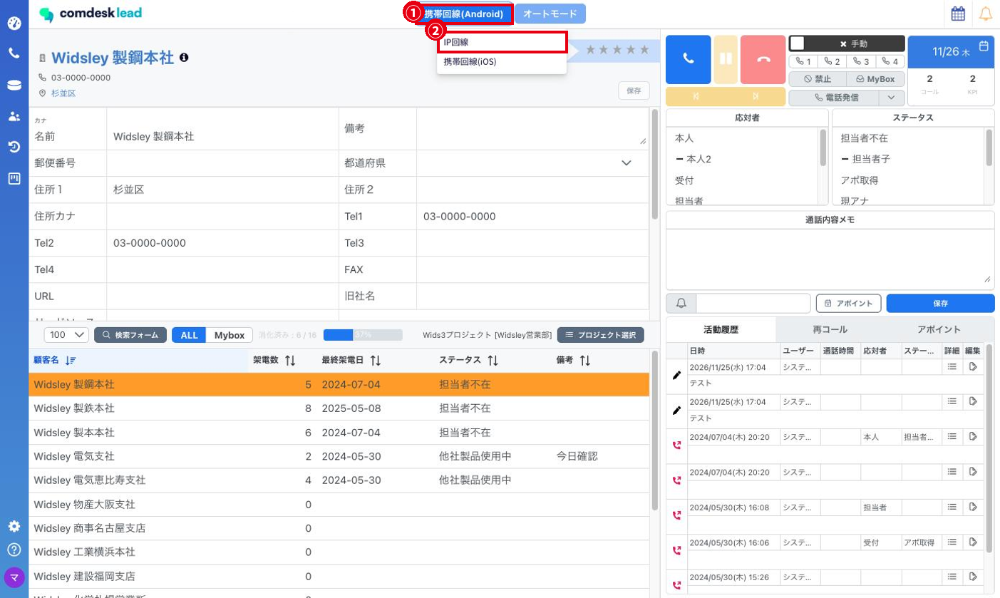
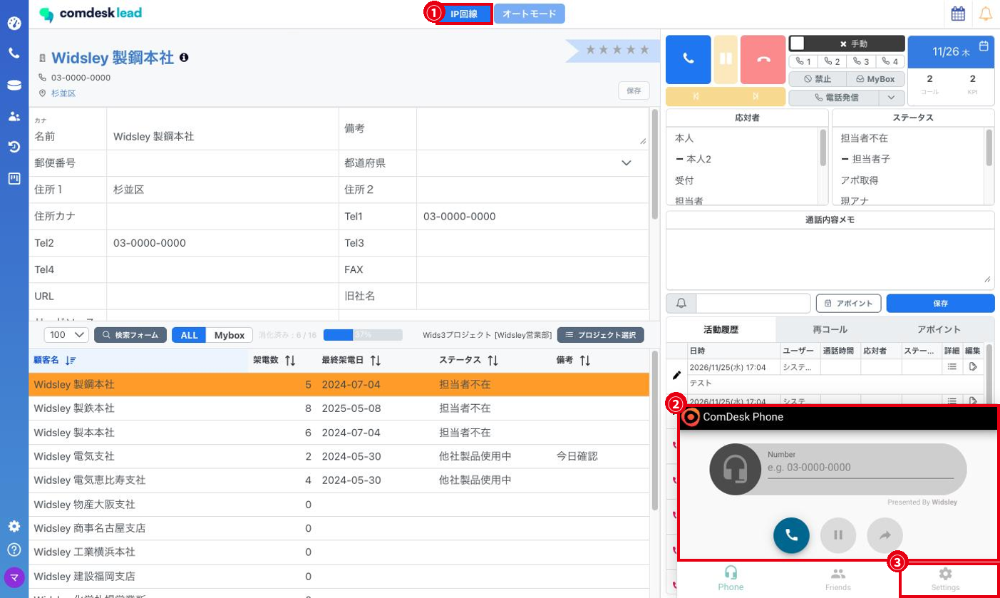
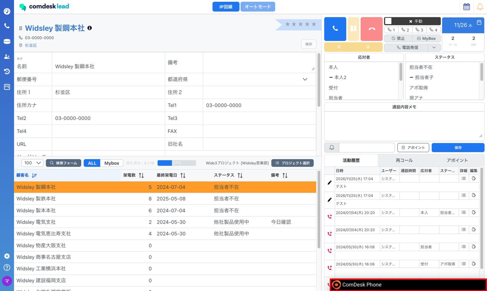
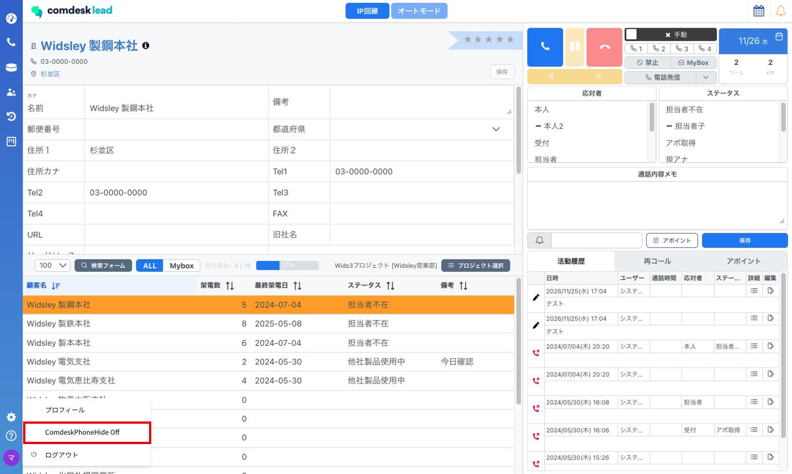
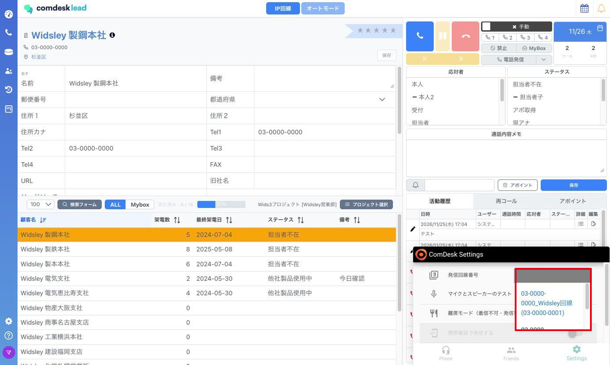
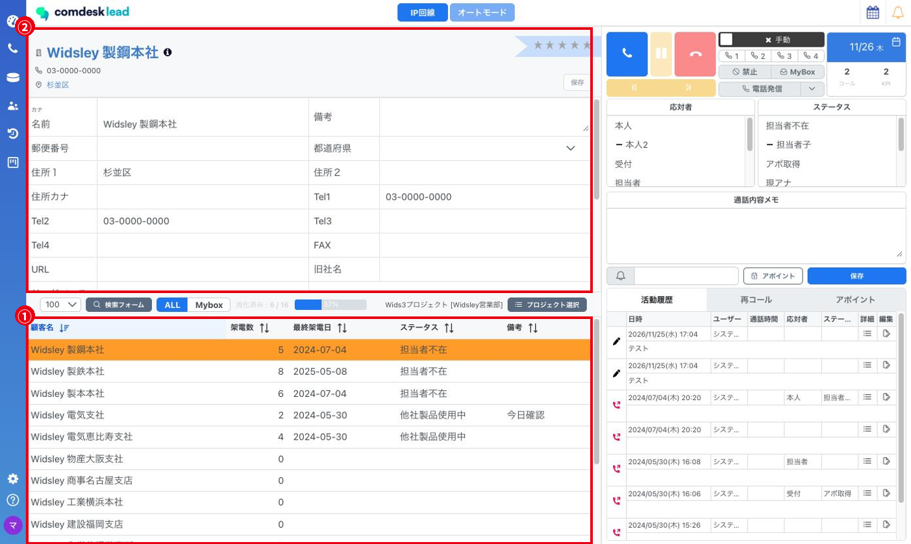
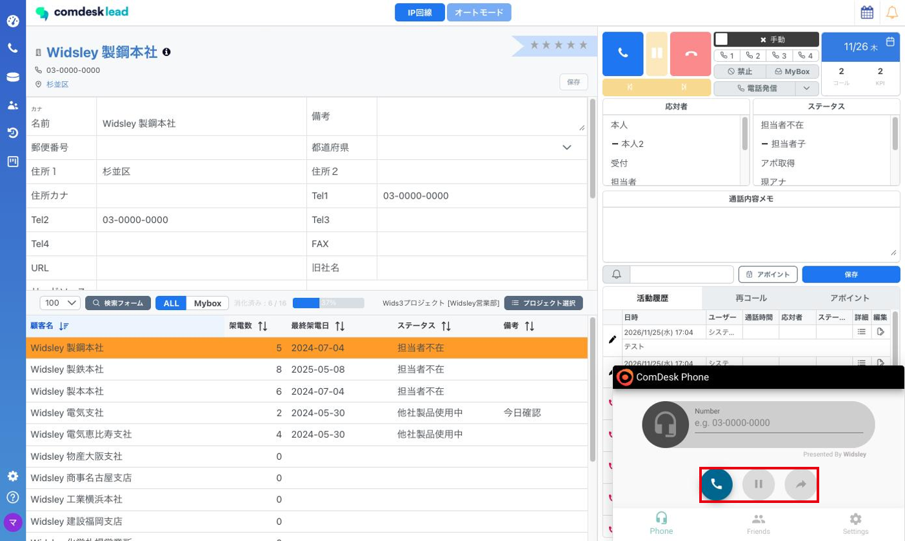
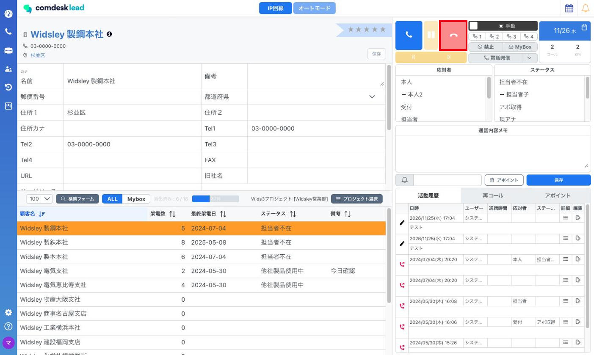

<Info>
2026年11月26日（木）夜間リリースにより、11月27日（金）以降はコール画面のデザインが変更となりました。本記事は変更後の画面でご案内しています。変更内容は[リリースノート](/release/notes/2026-11-26-release-notes)をご確認ください。
</Info>

IP回線で架電する方法をご案内します。

## IP回線を選択する

画面上部の回線種別ボタン（①）をクリックし、表示された選択肢から「IP回線」（②）を選択します。ボタンに「IP回線」と表示されていれば、IP回線に切り替わっています。

<Frame caption="画面上部の回線種別ボタン">
  
</Frame>

## 発信する回線を選択して架電する

メイン番号以外の回線で発信する場合は、以下の手順で発信する回線番号を選択します。

<Steps>
  <Step title="ComDesk PhoneのSettingsを開く">
    1. 画面上部の回線種別が「IP回線」であることを確認します（①）。
    2. 画面右下にComDesk Phoneを表示させます（②）。
    3. 「Settings」をクリックします（③）。

    <Frame caption="ComDesk PhoneのSettings">
      
    </Frame>

    <Note>
    ComDesk Phoneのポップアップ画面が見当たらない場合は、以下の2点をご確認ください。

    **最小化されている場合**

    画面右下のComDesk Phoneの黒いバーをクリックしてください。

    <Frame caption="最小化されたComDesk Phone">
      
    </Frame>

    **最小化したバーも表示されていない場合**

    画面左下のアカウントアイコンを選択し、「ComdeskPhoneHide Off」を選択してください。

    <Frame caption="アカウントアイコンのメニュー">
      
    </Frame>
    </Note>
  </Step>
  <Step title="発信回線番号を選択する">
    「発信回線番号」の枠を選択すると、発信可能なIP回線が表示されます。発信したい番号を選択してください。選択した番号で発信される状態になります。

    <Frame caption="発信回線番号の選択">
      
    </Frame>
  </Step>
  <Step title="架電するリストを選択する">
    ComDesk Phoneの「Phone」に戻り、画面下部のリストから架電したいリストを選択します。

    <Frame caption="リストの選択">
      
    </Frame>
  </Step>
  <Step title="発信する">
    画面右上の発信ボタンをクリックすると、ComDesk Phoneに番号が自動でコピーされ、発信できます。

    <Frame caption="発信ボタン">
      
    </Frame>
  </Step>
  <Step title="必要に応じて保留・転送する">
    通話中は、ComDesk Phoneの赤枠内のボタンから保留・転送ができます。

    <Frame caption="ComDesk Phoneの操作ボタン">
      
    </Frame>
  </Step>
  <Step title="切電して結果を保存する">
    切電ボタンをクリックして切電します。切電後、「応対者」と「ステータス」を選択して「保存」をクリックしてください。

    <Frame caption="切電ボタン">
      
    </Frame>

    結果の保存方法は[架電終了後に結果を保存する](/guide/user/12750855872025)をご確認ください。
  </Step>
</Steps>

その他ご不明点などございましたら、[**サポートチームまでお問い合わせ**](#contact)をお願い致します。
