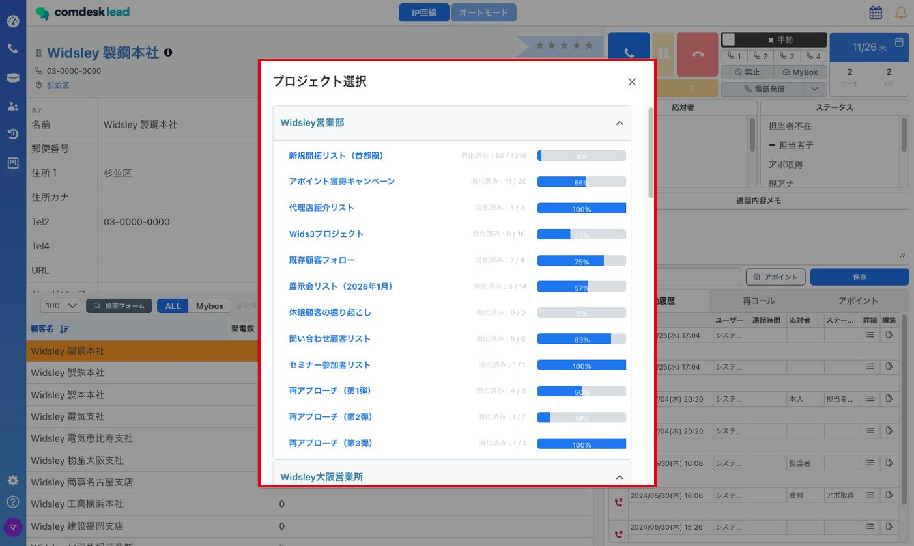
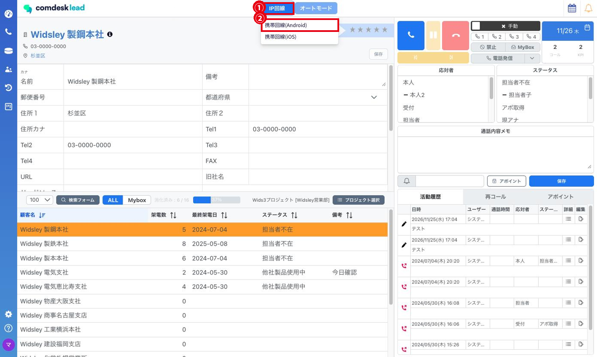
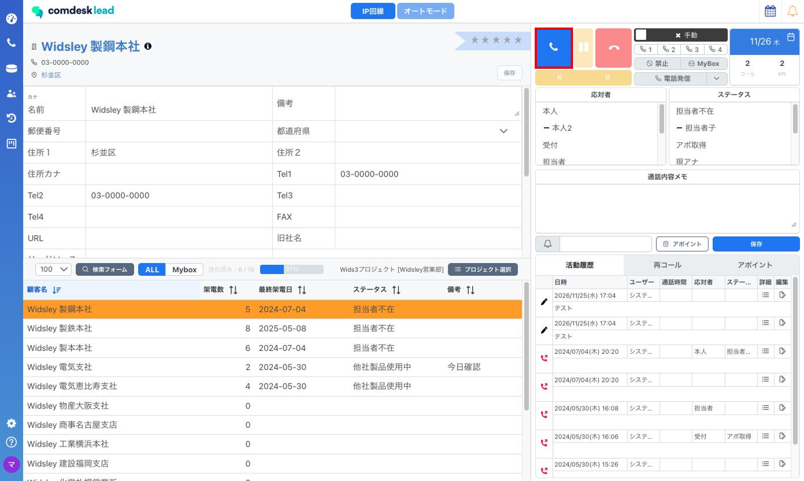

<Info>
2026年11月26日（木）夜間リリースにより、11月27日（金）以降はコール画面のデザインが変更となりました。本記事は変更後の画面でご案内しています。変更内容は[リリースノート](/release/notes/2026-11-26-release-notes)をご確認ください。
</Info>

Comdesk Leadは、携帯回線とIP回線から架電が可能です。

本記事では、携帯回線（Android）からの架電方法を説明いたします。

<Note>
携帯回線での発信は、Android端末でのみご利用いただけます。
</Note>

<Steps>
  <Step title="CallServerにログインする">
    携帯アプリ「CallServer」にログインします。ログイン方法は[携帯回線発信制御アプリ（CallServer）のログイン](/guide/user/12744354427033)をご確認ください。
  </Step>
  <Step title="待ち受け待機中の画面を表示させ続ける">
    「待ち受け待機中」を表示させ、そのままの画面で表示させ続けます。スリープに入ってしまったり、ロックをかけてしまうと架電が行えません。

    画面点灯時間（スリープするまでの時間）の設定については[画面点灯時間を設定する](/hardware/device/12785391736345)をご確認ください。

    <Frame caption="CallServerの待ち受け待機中の画面">
      
    </Frame>
  </Step>
  <Step title="パソコンでComdesk Leadにログインする">
    ログイン方法は[Comdesk Leadにログインする](/guide/user/12735918031513)をご確認ください。

    <Warning>
    CallServerとComdesk Leadにログインする際は、必ず同一のログインIDとパスワードを使用してください。それぞれ別のログインIDとパスワードを使用すると、連動しなくなります。
    </Warning>
  </Step>
  <Step title="プロジェクトを選択する">
    「プロジェクト選択」のポップアップから、架電対象のプロジェクトを選択します。

    <Frame caption="プロジェクト選択のポップアップ">
      
    </Frame>
  </Step>
  <Step title="回線種別が携帯回線(Android)になっているか確認する">
    画面上部の回線種別ボタン（①）に「携帯回線(Android)」と表示されているか確認します。

    「IP回線」と表示されている場合は、回線種別ボタンをクリックし、表示された選択肢から「携帯回線(Android)」（②）を選択してください。

    <Frame caption="回線種別の選択">
      
    </Frame>
  </Step>
  <Step title="リストを選択して発信する">
    画面下部のリストを選択し、画面右上の発信ボタンをクリックすると、携帯電話から発信できます。

    <Frame caption="発信ボタン">
      
    </Frame>
  </Step>
  <Step title="結果を保存する">
    アクティビティ結果の保存方法は[架電終了後に結果を保存する](/guide/user/12750855872025)をご参照ください。
  </Step>
</Steps>

その他ご不明点などございましたら、[**サポートチームまでお問い合わせ**](#contact)をお願い致します。
