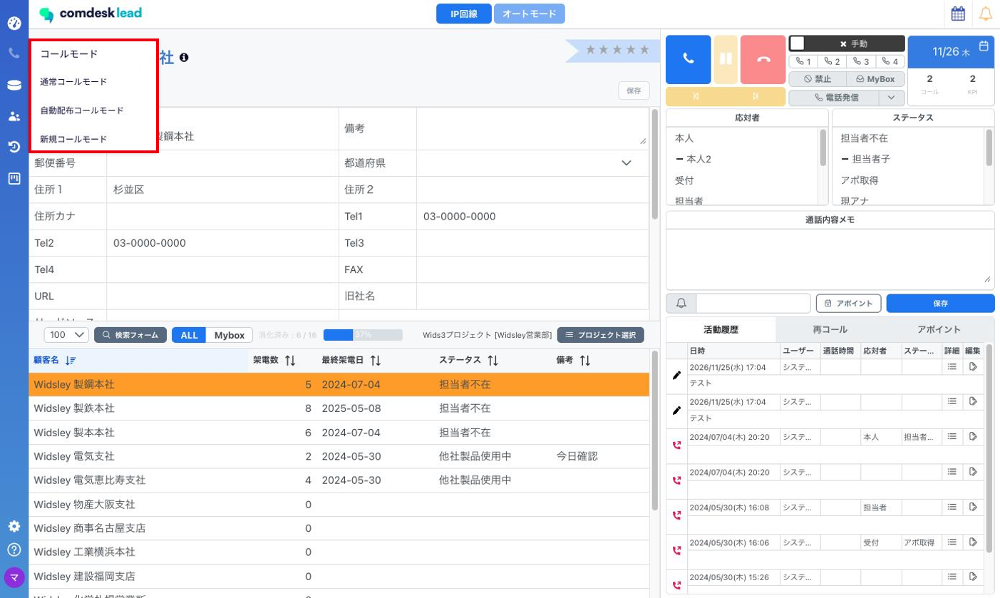
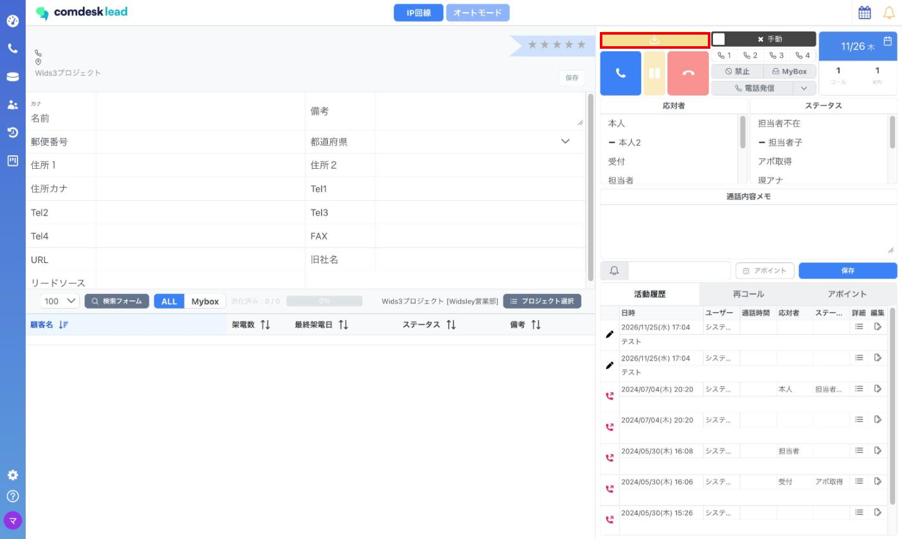
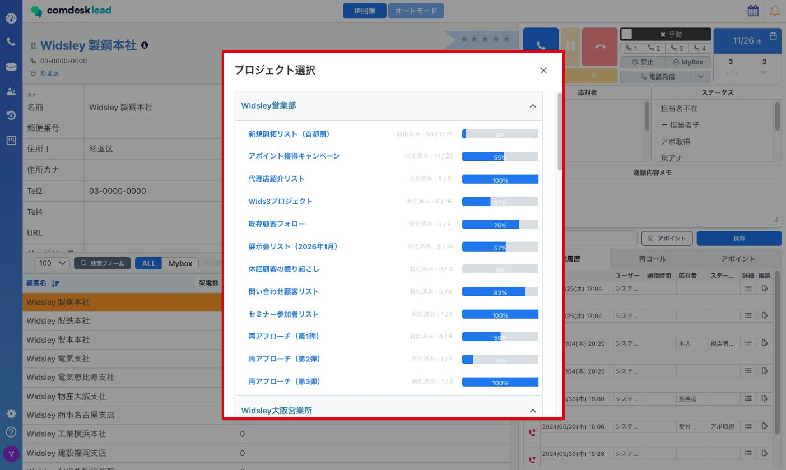
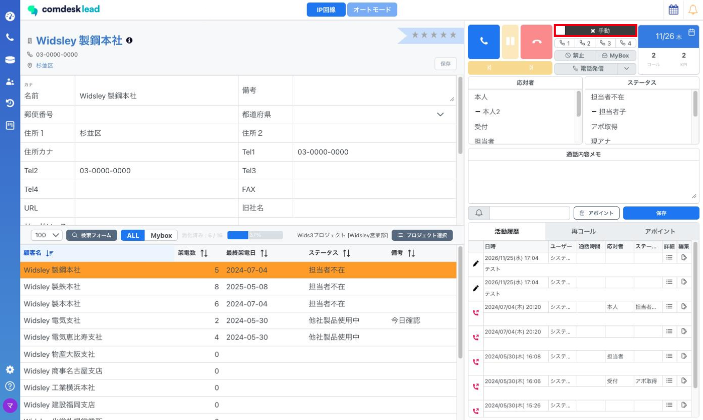

<Info>
2026年11月26日（木）夜間リリースにより、11月27日（金）以降はコール画面のデザインが変更となりました。本記事は変更後の画面でご案内しています。変更内容は[リリースノート](/release/notes/2026-11-26-release-notes)をご確認ください。
</Info>

同一プロジェクトに対して複数ユーザーが一斉に架電する場合は、配布コールモードをご利用ください。

**配布コールモード**は、プロジェクト内にある未配布のリストを対象に、ランダムで配布するモードです。コール画面のメニューでは「自動配布コールモード」と表示されます。

<Tip>
配布コールモードに加えて**オートコールモード**で架電を行うと、さらに効率が上がります。
</Tip>

## 配布コールモードでリストを取り込む

画面左側メニューの電話アイコンにカーソルを合わせ、「コールモード」メニューから「自動配布コールモード」を選択します。

<Frame caption="コールモードメニュー">
  
</Frame>

画面右上の配布ボタンをクリックすると、リストを取り込みます。

<Frame caption="配布ボタン">
  
</Frame>

配布コールモードでの架電方法は[リストに対して架電する](/guide/user/12745769763609)をご確認ください。

## アポイント獲得率と架電効率を上げる例

<Steps>
  <Step title="アポイントが取れやすい業種をプロジェクトに登録する">
    アポイントが取れやすい業種をプロジェクトに登録します。
  </Step>
  <Step title="配布コールモードでプロジェクトを選択する">
    配布コールモードで、手順1のプロジェクトを選択します。

    <Frame caption="プロジェクト選択画面">
      
    </Frame>
  </Step>
  <Step title="オートコールで架電する">
    配布コールモードを選択し、オートコールで架電します。複数ユーザーで同一プロジェクトを選択することをおすすめします。

    <Frame caption="オートコールの設定">
      
    </Frame>
  </Step>
  <Step title="すべて配布済になるまで架電する">
    選択しているプロジェクトのリストがすべて「配布済」になるまで、オートコールが可能です。

    配布状況の確認方法は[配布状況の確認](/guide/admin/13896301861017)をご確認ください。
  </Step>
</Steps>

その他ご不明点などございましたら、[**サポートチームまでお問い合わせ**](#contact)をお願い致します。
