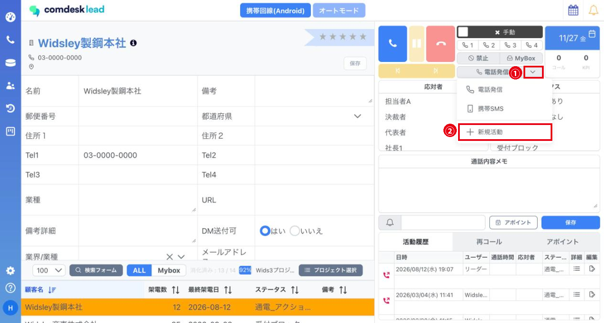
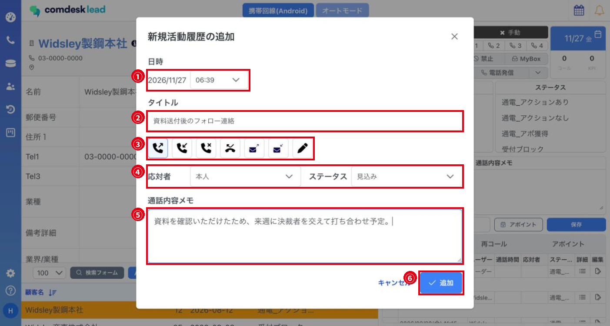
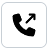
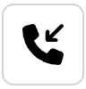
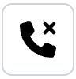
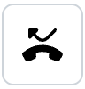
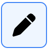

<Info>
2026年11月26日（木）夜間リリースで、コール画面から活動履歴を追加できるようになりました。変更内容は[リリースノート](/release/notes/2026-11-26-release-notes)をご確認ください。
</Info>

コール画面の「新規活動」から、顧客の活動履歴を手動で追加できます。Comdesk Leadを経由しなかった電話やSMS、対応メモなどを記録しておきたい場合にご利用ください。

## 活動履歴を追加する

<Steps>
  <Step title="顧客を選択する">
    コール画面下部のリストから、活動を追加する顧客をクリックします。

    <Note>
    顧客を選択していない状態では、新規活動を追加できません。
    </Note>
  </Step>
  <Step title="「新規活動」を選択する">
    画面右上の「電話発信」の右側にある「∨」（①）をクリックし、表示されたメニューから「新規活動」（②）を選択します。

    <Frame caption="電話発信メニュー">
      
    </Frame>
  </Step>
  <Step title="活動の内容を入力する">
    「新規活動履歴の追加」画面で、次の項目を入力します。

    <Frame caption="新規活動履歴の追加画面">
      
    </Frame>

    | 番号 | 項目 | 内容 |
    | --- | --- | --- |
    | ① | 日時 | 日付は当日です。時刻は「新規活動」を選択した時刻が入り、15分刻みで変更できます。 |
    | ② | タイトル（必須） | 活動のタイトルを入力します。 |
    | ③ | 活動の種類 | アイコンで選択します（下表参照）。初期状態は「メモ」です。 |
    | ④ | 応対者・ステータス | アクティビティ結果を選択します。活動の種類が発信・着信・不在発信・不在着信の場合は、ステータスが必須です。 |
    | ⑤ | 通話内容メモ | 対応内容などを入力します。 |

    活動の種類のアイコンは、左から次のとおりです。

    | アイコン | 種類 | ステータスの選択 |
    | --- | --- | --- |
    |  | 発信 | 必須 |
    |  | 着信 | 必須 |
    |  | 不在発信 | 必須 |
    |  | 不在着信 | 必須 |
    |  | SMS発信 | 任意 |
    |  | SMS着信 | 任意 |
    |  | メモ | 任意 |

    <Note>
    活動の種類が「SMS発信」「SMS着信」「メモ」の場合は、タイトルを入力すれば追加できます。「発信」「着信」「不在発信」「不在着信」の場合は、タイトルに加えてステータスの選択が必要です。
    </Note>
  </Step>
  <Step title="追加する">
    「追加」ボタン（⑥）をクリックします。追加した活動は、コール画面右下の「活動履歴」タブに表示されます。
  </Step>
</Steps>

その他ご不明点などございましたら、[**サポートチームまでお問い合わせ**](#contact)をお願い致します。
