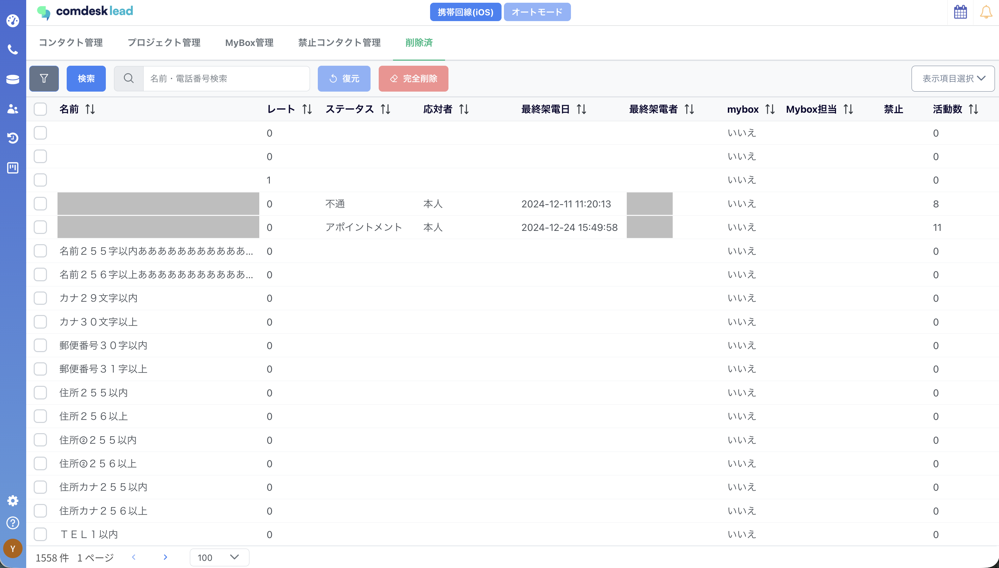
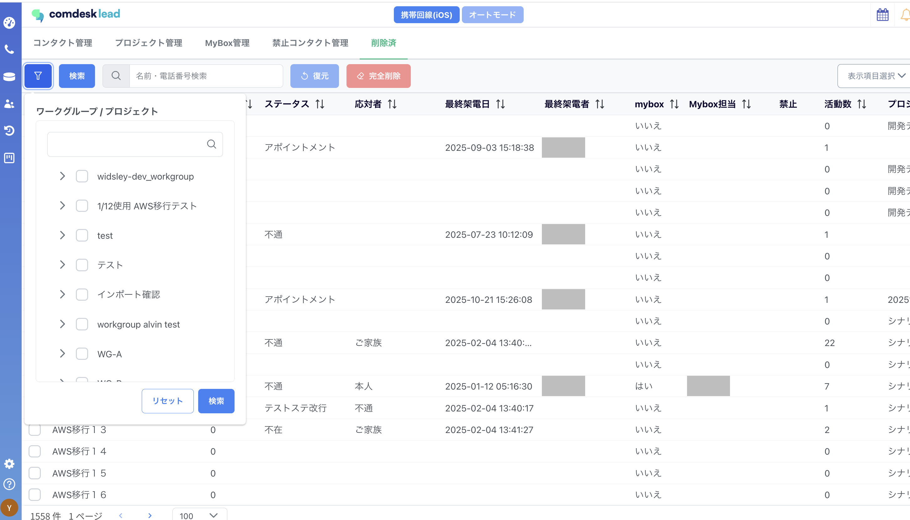
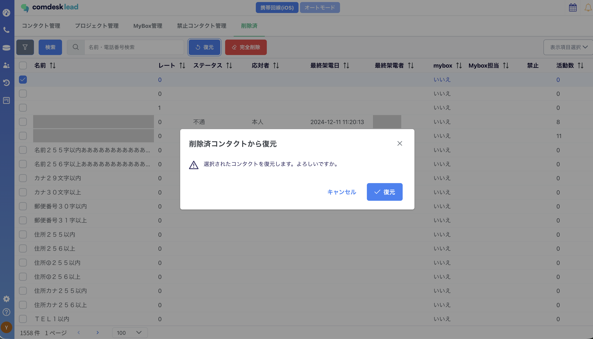
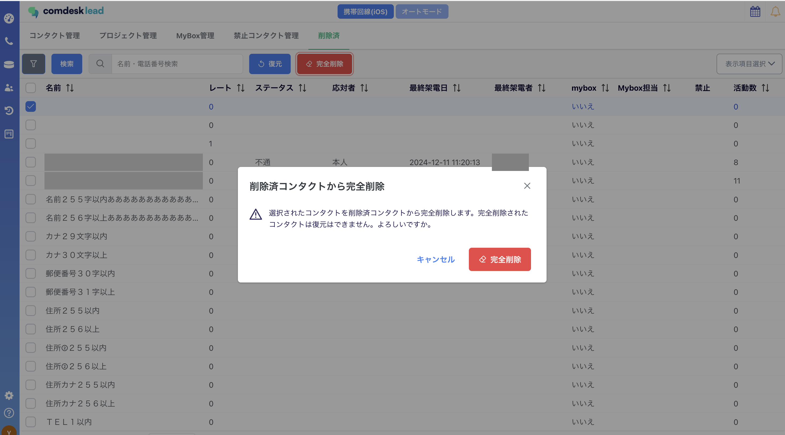

［コンタクト管理］で削除したコンタクトは、［削除済］タブで確認できます。［削除済］タブでは、削除したコンタクトを元に戻したり（復元）、完全に削除したりできます。

---

## 削除したコンタクトを確認する

1. メニューから［コンタクト管理］を開きます。
2. 画面上部の［削除済］タブを押します。

削除したコンタクトが一覧で表示されます。表示される項目は、［表示項目選択］で変更できます。

### 削除したコンタクトを絞り込む

次の方法で、表示するコンタクトを絞り込めます。

| 方法 | 操作 |
| :-- | :-- |
| 名前・電話番号で探す | 検索欄に名前または電話番号を入力します。 |
| ワークグループ・プロジェクトで絞り込む | 絞り込みボタン（漏斗のアイコン）を押し、ワークグループまたはプロジェクトを選択して［検索］を押します。 |
| 条件を指定して検索する | ［検索］を押すと［コンタクト検索］が表示されます。左のリストから検索条件を選択して、［検索］を押します。 |

## 削除したコンタクトを復元する

1. ［削除済］タブで、復元するコンタクトのチェックボックスを選択します。
2. ［復元］を押します。
3. ［削除済コンタクトから復元］が表示されたら、［復元］を押します。

<Info>
  ［復元］と［完全削除］は、コンタクトを1件以上選択すると押せるようになります。 
</Info>

## コンタクトを完全に削除する

<Warning>
  完全に削除したコンタクトは復元できません。
</Warning>

1. ［削除済］タブで、完全に削除するコンタクトのチェックボックスを選択します。
2. ［完全削除］を押します。
3. ［削除済コンタクトから完全削除］が表示されたら、［完全削除］を押します。

## 関連ページ

- [リストを削除する](https://help.comdesk.com/features/advanced/12787129797529)
